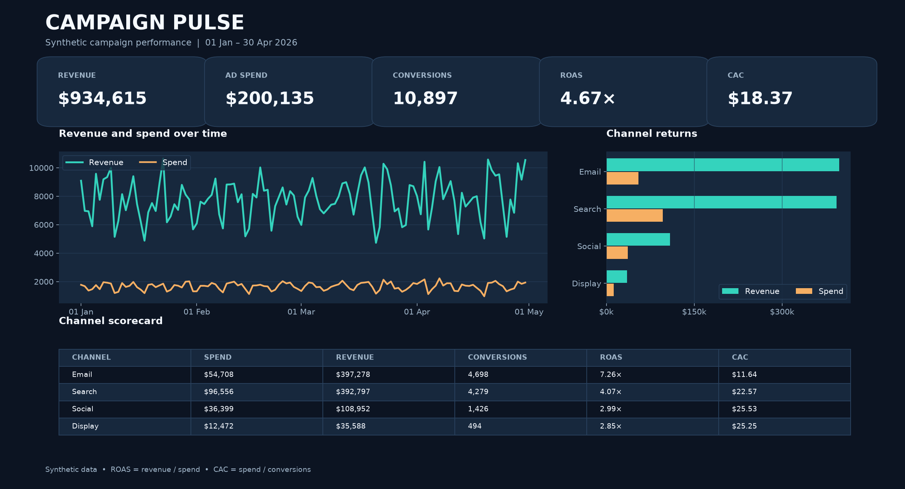

# Campaign Pulse — Marketing Dashboard

A local, interactive campaign dashboard for comparing spend, attributed revenue and acquisition efficiency across channels. It uses **synthetic data only** and runs without an API key, database or network connection after dependencies are installed.



## Question and data flow

Which channels generate the best return, and does that result change when the date range changes?

`Fixed-seed generator → campaign-day CSV → schema and funnel validation → aggregate KPIs → Streamlit + Plotly dashboard`

The checked-in [data/campaigns.csv](data/campaigns.csv) has 960 rows: 120 dates (1 January–30 April 2026), four channels and two campaigns per channel. `marketing.py` regenerates the file with seed `20260927`. Each row is unique at `(date, channel, campaign)` and includes impressions, clicks, conversions, spend and attributed revenue in USD. The values are simulated; they are not benchmark or real company data.

## Run locally

Python 3.13 is recommended. From this project directory in PowerShell:

```powershell
python -m venv .venv
.venv\Scripts\python.exe -m pip install -r requirements.txt
.venv\Scripts\python.exe marketing.py
.venv\Scripts\streamlit.exe run app.py
```

Open the local URL printed by Streamlit. Use the sidebar to filter an **inclusive** start/end date and one or more channels. The KPI cards, trend, channel comparison and scorecard update from the same filtered rows. An empty selection displays a message instead of dividing by zero.

Regenerate the static evidence and run the automated checks:

```powershell
.venv\Scripts\python.exe build_preview.py
.venv\Scripts\python.exe -m pytest -q
```

On macOS/Linux, replace `.venv\Scripts\python.exe` with `.venv/bin/python` and run `streamlit` via `.venv/bin/streamlit`.

## Metric definitions

| Metric | Calculation | Meaning |
| --- | --- | --- |
| Revenue | Sum of `revenue_usd` | Same-day attributed revenue from the simulated campaign |
| Spend | Sum of `spend_usd` | Simulated advertising spend |
| ROAS | Revenue ÷ spend | Attributed revenue per advertising dollar |
| CAC | Spend ÷ conversions | Ad cost per acquired customer; the model assumes one conversion equals one new customer |
| CTR | Clicks ÷ impressions | Share of impressions that produced a click |
| Conversion rate | Conversions ÷ clicks | Share of clicks that converted |

All ratios divide **totals after filtering**, so they are weighted correctly; no row-level percentages are averaged. A zero denominator is undefined and shown as `—`. Revenue excludes tax, refunds and organic sales. CAC excludes non-ad acquisition costs and should not be read as a real business CAC.

For the checked-in dataset, `assets/metrics.json` records **$934,615.04 revenue**, **$200,134.62 spend**, **10,897 conversions**, **4.67× ROAS** and **$18.37 CAC** (displayed values rounded). The preview PNG is rendered from the same CSV, with no hand-entered KPI values.

## Files and verification

- `marketing.py`: repeatable data generation, grain/funnel validation, filtering and KPI calculations.
- `app.py`: Streamlit dashboard with Plotly trend and channel comparison.
- `build_preview.py`: reproducible static preview and machine-readable totals in `assets/`.
- `tests/test_marketing.py`: hand-calculated KPI expectations, inclusive filters, zero denominators, invalid funnels and generator reproducibility.

The app is intended for local review. The PNG makes the design visible on GitHub without running Streamlit. Licensed under [MIT](LICENSE).
